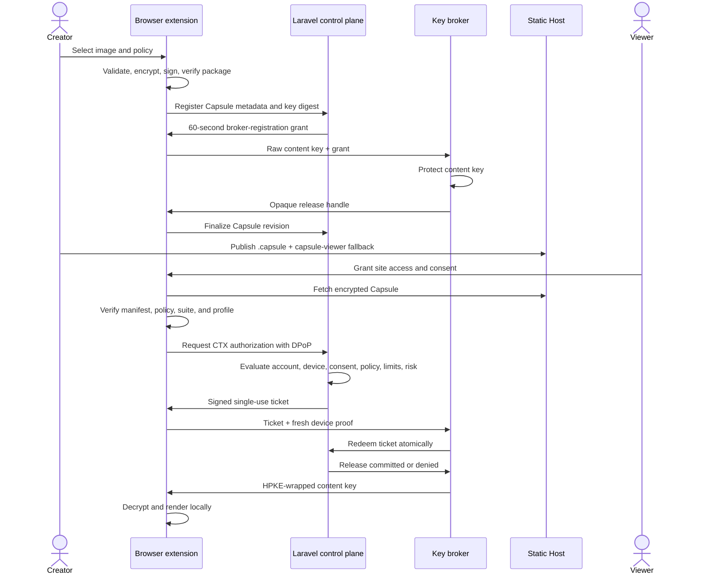

# System Architecture

Status: Current implemented behavior
Last updated: 2026-08-26

## Purpose

This page records the current Share Capsules runtime shape, subsystem
boundaries, data flow, and lifecycle contracts.

## Runtime Components

- **Laravel control plane:** account lifecycle, Fortify/Passport
  authentication, OAuth/DPoP token issuance, device registration, CTX provider
  discovery, CTX authorization, challenge attempts, Capsule registry, metrics,
  automation risk, and broker callback handling.
- **Isolated broker runtime:** separately bootable Laravel component selected
  by `SHARECAPSULES_COMPONENT=broker`; exposes broker discovery, health,
  content-key registration, key release, and authenticated internal lifecycle
  APIs while omitting ordinary account/control-plane routes.
- **Browser extension:** trusted creator and Viewer runtime for local file
  handling, signing-key recovery, Capsule building, Host markup generation,
  Viewer discovery, account connection, device keys, consent, authorization,
  broker redemption, decryption, and rendering.
- **Shared TypeScript packages:** Capsule contracts, schema validators,
  canonical JSON, ZIP/package validation, payload encryption, manifest
  signature, policy digest, CTX contracts, HPKE context, creator helpers, and
  cross-language fixtures.
- **Static Host/showcase:** ordinary web surfaces that serve fallback content
  and encrypted Capsule files without receiving protected secrets.
- **Operations assets:** runbooks, release evidence, benchmark records,
  production change ledger, and extension release/supply-chain checks.

## Module Map

| Area | Implementation |
| --- | --- |
| Account lifecycle | `code/app/Account`, `code/app/Actions/Fortify`, `code/app/Http/Controllers/Account`, `code/routes/web.php` |
| OAuth and DPoP | `code/app/OAuth`, `code/bootstrap/app.php`, Passport route bindings |
| Viewer devices | `code/app/ViewerDevices`, `code/app/Http/Controllers/Api/ViewerDeviceRegistrationController.php` |
| Capsule registry | `code/app/Capsules/Registry`, `code/app/Http/Controllers/Api/CapsuleRegistrationController.php` |
| CTX policy/tickets | `code/app/Ctx/Policy`, `code/app/Ctx/Tickets`, `code/app/Http/Controllers/Ctx` |
| CTX challenges | `code/app/Ctx/Challenges`, challenge controllers and views |
| CTX metrics/risk | `code/app/Ctx/Metrics`, `code/app/Ctx/Risk` |
| Broker isolation | `code/bootstrap/broker.php`, `code/app/Broker`, `code/routes/broker*.php` |
| Extension creator/viewer | `code/apps/browser-extension/src` |
| Protocol packages | `code/packages/capsule-core`, `code/packages/ctx-client`, `code/packages/capsule-creator`, `code/packages/test-fixtures` |

## End-To-End Data Flow

## Creation Boundary

The extension creates the content key and encrypts payload bytes locally. The
control plane receives a content-key digest and safe metadata, not the raw key
or plaintext. The broker receives the raw content key directly from trusted
tooling, validates a short-lived grant with the control plane, protects the key
through the custody adapter, and returns an opaque release handle.

Capsule publication is two-phase. A broker registration is provisional until
the extension builds the archive, reopens it with the strict reader, and
finalizes the pending revision. Pending registrations expire and are cleaned by
scheduled jobs.

## Viewing Boundary

The content script discovers explicit `<capsule-viewer>` elements only on
approved top-level origins. It passes a resolved Capsule URL and generic frame
lifecycle messages to extension-owned components. The Host DOM never receives
OAuth tokens, device private keys, tickets, content keys, plaintext, raw policy
evidence, or detailed trust results.

The Viewer downloads the complete V1 Capsule, validates package structure and
signed metadata, establishes or reuses a DPoP-bound account connection, obtains
policy consent, requests CTX authorization, redeems through the broker, and
renders in the extension boundary. Every open requires fresh online
authorization and key release.

## Broker And Control-Plane Split

The same code artifact can boot as a control-plane runtime or broker runtime.
The broker runtime is configured through `bootstrap/broker.php` and intentionally
omits account, session, Fortify, Passport, and storage-serving routes. In
development or same-install deployments, route logic can dispatch broker
metadata/health based on host identity while retaining distinct service
boundaries.

The broker validates tickets and proofs locally, prepares HPKE wrapping, then
calls the control plane for online redemption before returning the wrapped key.
The control plane is the authority for account/device state, pending tickets,
revocation, access windows, limits, and committed-release counters.

## Lifecycle Models

- **Ticket signing keys:** published, active, retiring, retired, and
  emergency-revoked. Rotation publishes a replacement before activation and
  retains old public keys for the ticket lifetime plus accepted skew.
- **Broker content keys:** pending, active, paused, revoked, and destroyed
  states are managed by broker lifecycle APIs.
- **Capsule registry:** pending registration, active revision, paused/resumed
  release state, revoked revision, deleted inventory state, and immutable safe
  metadata.
- **Account closure:** active accounts can enter a 30-day recovery period;
  closure pauses creator releases and prevents creation/viewing; restoration
  requires broker resume.
- **Permanent deletion:** deletes personal data and detailed trust profile,
  destroys broker key material, and records deletion-ledger obligations.
- **Viewer devices:** registered devices may be named, suspended, activated, or
  permanently revoked; device revocation invalidates continuing extension
  access.

## Provider And Registry Boundary

Capsules record CTX issuer and broker identities in the signed manifest. The
open protocol permits independent implementations, but the official Share
Capsules creator and Viewer tools recognize only services in the official
trust list. V1 recognizes only the Share Capsules CTX Provider and Key Broker.

The registry governs official recognition, not universal protocol validity.
Official tools must refuse unknown, revoked, or incompatible services before
sending credentials, proofs, tickets, authorization requests, or key-release
requests.

## Deferred Architecture

The current system deliberately defers arbitrary federation, additional content
profiles, adaptive renditions, chunked payloads, range-based retrieval,
offline authorization, mobile/native Viewers, lower-assurance server or web
decryption, and provider portability.

## Migration Coverage

Detailed legacy-to-KB provenance is tracked in the
[migration inventory](../migration-inventory.md). Architecture-specific durable
facts now live in this area and the linked detailed pages in its README.
